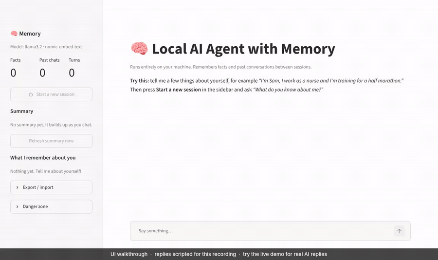
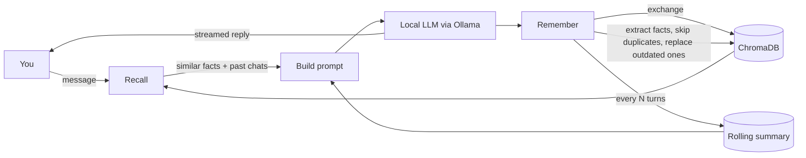

# 🧠 Local AI Agent with Memory

[](https://github.com/naveditachaudhary-pixel/local-ai-agent-memory/actions/workflows/tests.yml)

A personal assistant that runs **entirely on your own machine** and **remembers you between sessions**.
Tell it your name, your job or what you're working on, close the app, come back tomorrow, and it still knows.

No API keys, no cloud, and no data leaves your laptop. The model runs locally through [Ollama](https://ollama.com).

**Try it:** [▶ Live demo with real AI](https://local-ai-agent-memory.streamlit.app) · [Browser demo, no sign-up](https://naveditachaudhary-pixel.github.io/local-ai-agent-memory/) · [Video walkthrough (MP4)](docs/demo.mp4)



<sub>The walkthrough above uses scripted replies so it could be recorded without a model. The live demo and the app on your own computer use a real one.</sub>

## Features

- **Long-term memory by meaning.** Facts about you and past conversations are stored as embeddings in a local [ChromaDB](https://www.trychroma.com/) database, then recalled by semantic similarity rather than keyword matching.
- **Automatic fact extraction.** After each message, the model pulls out durable facts ("The user works as a data analyst.") and skips small talk. Near-duplicates are detected and not stored twice.
- **Facts stay current.** Say "I just moved to Austin" and the old city is replaced, not kept alongside it. Unrelated facts are left alone.
- **Reinforcement and decay.** Memories that keep being useful rank a little higher, and ones nobody has needed for months slowly sink.
- **Rolling summary.** Every few turns the agent rewrites a short summary of everything it knows, so long histories stay compact.
- **Transparent and controllable.** The sidebar shows exactly what the agent remembers. Forget any single fact with one click, export everything to a JSON file and import it on another machine, or wipe it all.
- **Any local model.** Switch between the chat models you've pulled in Ollama from the sidebar.
- **Streaming replies** in a clean Streamlit chat UI, plus a *Start a new session* button to prove the memory outlasts the chat.
- **Measured.** A [memory benchmark](#benchmark) scores recall, outdated facts and answer accuracy, with and without fact updating.
- **Tested.** Unit tests, end-to-end UI tests and a Docker build run in CI with a fake model, so they need no GPU or Ollama.

## How it works



Each turn follows **recall → respond → remember**:

1. **Recall:** the message is embedded with `nomic-embed-text`, and the closest facts and past exchanges are pulled from ChromaDB (cosine distance, with a cutoff so unrelated memories stay out). The order is then nudged by how often each memory has been useful and how recently.
2. **Respond:** the system prompt is assembled from the rolling summary, the recalled facts and related past exchanges, plus the last few turns verbatim. The local model streams its answer.
3. **Remember:** the exchange is stored and new facts are extracted. Each new fact is compared with the closest facts already stored: exact repeats are skipped, and if any are related, the model is asked which of them the new fact makes outdated, and those are removed. Every few turns the summary is refreshed.

## Quick start

### Option A: Docker (one command)

```bash
git clone https://github.com/naveditachaudhary-pixel/local-ai-agent-memory.git
cd local-ai-agent-memory
docker compose up
```

Open http://localhost:8501. The first start downloads the two models (about 2.3 GB), and memory is kept in a Docker volume between restarts. To use another model, run `AGENT_CHAT_MODEL=mistral docker compose up`. If you have an NVIDIA GPU, uncomment the `deploy` block in `docker-compose.yml`.

### Option B: Python

**1. Install Ollama and pull two models** (about 2.3 GB in total):

```bash
# install from https://ollama.com, then:
ollama pull llama3.2           # chat model
ollama pull nomic-embed-text   # embedding model
```

**2. Install and run the app** (Python 3.10+):

```bash
git clone https://github.com/naveditachaudhary-pixel/local-ai-agent-memory.git
cd local-ai-agent-memory
python -m venv .venv && source .venv/bin/activate   # Windows: .venv\Scripts\activate
pip install -r requirements.txt
streamlit run app.py
```

Open http://localhost:8501 and introduce yourself. Then restart the app and ask *"What do you remember about me?"*

## Online demos

The app is built to run on your own computer, so there are two ways to try it without installing anything:

| Demo | Replies | Memory |
|---|---|---|
| [Live demo](https://local-ai-agent-memory.streamlit.app) on Streamlit Community Cloud | Real model (`openai/gpt-oss-20b` on Groq) | Real vector memory, private to your browser tab and deleted when you close it |
| [Browser demo](https://naveditachaudhary-pixel.github.io/local-ai-agent-memory/) on GitHub Pages | Pre-written templates | Simple pattern-based memory saved in your browser, which also updates facts that change |

**Demo mode.** When a `GROQ_API_KEY` is configured, `app.py` switches to demo mode:
- Chat goes to a hosted model, and embeddings run inside the app with ChromaDB's built-in MiniLM model.
- Each visitor gets their own temporary memory.
- Each visitor is limited to 25 messages.

**To deploy your own copy:**
1. Fork this repo.
2. Create a free API key at [console.groq.com](https://console.groq.com).
3. On [share.streamlit.io](https://share.streamlit.io), create an app from your fork with `app.py` as the entry point.
4. Under **Advanced settings → Secrets**, add:

```toml
GROQ_API_KEY = "your-key"
```

## Benchmark

`bench/` holds 10 short conversations: 4 test plain recall, and 6 change a fact partway through (a move, a new job, a changed preference, a corrected name). After each conversation the agent starts a new session and answers questions about it. For each question, the benchmark checks three things:
- whether the right fact was pulled into the prompt;
- whether an outdated fact was pulled in too;
- whether the reply was correct.

Every scenario runs twice, with fact updating off and on.

```bash
python -m bench                   # uses your local Ollama models
python -m bench --update-readme   # also refreshes the table below
```

<!-- bench:start -->
*Results will appear here after the first run of `python -m bench --update-readme` on a machine with Ollama.*
<!-- bench:end -->

## Configuration

Set any of these environment variables before starting the app:

| Variable | Default | What it does |
|---|---|---|
| `AGENT_CHAT_MODEL` | `llama3.2` | Any chat model you've pulled in Ollama (e.g. `mistral`, `qwen2.5`) |
| `AGENT_EMBED_MODEL` | `nomic-embed-text` | Embedding model used for memory |
| `AGENT_DATA_DIR` | `data` | Where the memory database and summary are stored |
| `AGENT_MAX_DISTANCE` | `0.55` | How similar a memory must be to be recalled (lower is stricter) |
| `AGENT_UPDATE_FACTS` | `1` | Set to `0` to keep every fact instead of replacing outdated ones |
| `OLLAMA_HOST` | `http://localhost:11434` | Point at Ollama running on another machine |
| `GROQ_MODEL` | `openai/gpt-oss-20b` | Hosted model used in demo mode |

## Project structure

```
agent/
  config.py    settings, all overridable with environment variables
  llm.py       model backends: Ollama (local) and a hosted model for the online demo
  memory.py    VectorMemory (ChromaDB) and SummaryStore (rolling summary)
  prompts.py   every prompt template in one place
  agent.py     the recall -> respond -> remember loop
app.py         Streamlit chat UI with the memory sidebar (switches to demo mode when a hosted-model key is set)
bench/         memory benchmark: scenarios and the scoring script
site/          the browser demo page, published with GitHub Pages
tests/         unit tests, end-to-end Streamlit tests and a benchmark smoke test, all using a fake model
Dockerfile, docker-compose.yml   one-command setup with Ollama
```

## Running the tests

```bash
pip install -r requirements-dev.txt
pytest -q
```

The tests swap in a small fake model with word-count embeddings, and a mock of the hosted API for the online demo, so they run in seconds without Ollama or a network connection.

## Design decisions

- **Plain Python over a framework.** The agent loop is about 100 lines, which keeps every step easy to read, test and change.
- **Facts and exchanges in one collection, tagged by type.** Recall can target each separately (facts are precise, exchanges give context) without managing two databases.
- **A distance cutoff on recall.** Without it, the agent drags loosely related memories into every prompt, which confuses small local models.
- **Ask the model only when it matters.** Checking whether a new fact replaces old ones costs an extra model call, so it only happens when a stored fact is close enough to be a candidate. Most messages skip it.
- **Decay nudges, it doesn't delete.** Old memories sink in the ranking but stay searchable, so a strong match from a year ago still wins over a weak recent one.
- **Forgiving JSON parsing.** Small local models often wrap JSON in extra text, so fact extraction pulls out the first `[...]` block and ignores anything malformed.

## Roadmap

- [x] Replace outdated facts when something changes
- [x] Memory benchmark
- [x] Reinforcement and decay in recall ranking
- [x] Export and import memory as JSON
- [x] One-command Docker setup
- [ ] Tool use (calendar, notes) with memory of past tool results
- [ ] Separate memory profiles for several people on one machine

## License

MIT © 2026 Navedita Chaudhary
