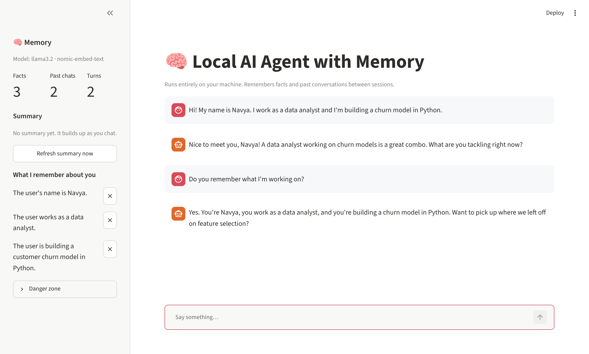
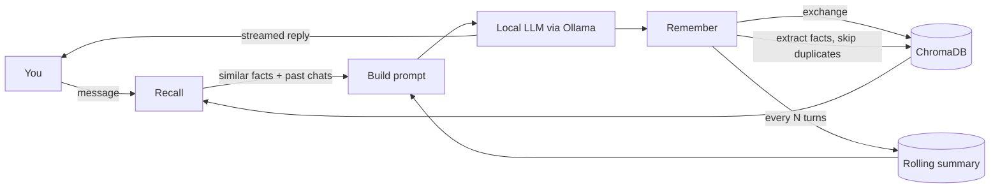

# 🧠 Local AI Agent with Memory

[](https://github.com/naveditachaudhary-pixel/local-ai-agent-memory/actions/workflows/tests.yml)

A personal assistant that runs **entirely on your own machine** and **remembers you between sessions**.
Tell it your name, your job or what you're working on, close the app, come back tomorrow, and it still knows.

No API keys, no cloud, and no data leaves your laptop. The model runs locally through [Ollama](https://ollama.com).



## Features

- **Long-term memory by meaning.** Facts about you and past conversations are stored as embeddings in a local [ChromaDB](https://www.trychroma.com/) database, then recalled by semantic similarity rather than keyword matching.
- **Automatic fact extraction.** After each message, the model pulls out durable facts ("The user works as a data analyst.") and skips small talk. Near-duplicates are detected and not stored twice.
- **Rolling summary.** Every few turns the agent rewrites a short summary of everything it knows, so long histories stay compact.
- **Transparent and controllable.** The sidebar shows exactly what the agent remembers. Forget any single fact with one click, or wipe everything.
- **Streaming replies** in a clean Streamlit chat UI.
- **Tested.** Unit tests and an end-to-end UI test run in CI with a fake model, so they need no GPU or Ollama.

## How it works



Each turn follows **recall → respond → remember**:

1. **Recall:** the message is embedded with `nomic-embed-text`, and the closest facts and past exchanges are pulled from ChromaDB (cosine distance, with a cutoff so unrelated memories stay out).
2. **Respond:** the system prompt is assembled from the rolling summary, the recalled facts and related past exchanges, plus the last few turns verbatim. The local model streams its answer.
3. **Remember:** the exchange is stored, new facts are extracted and de-duplicated, and every few turns the summary is refreshed.

## Quick start

**1. Install Ollama and pull two models** (about 2.3 GB in total):

```bash
# install from https://ollama.com, then:
ollama pull llama3.2           # chat model
ollama pull nomic-embed-text   # embedding model
```

**2. Install and run the app** (Python 3.10+):

```bash
git clone https://github.com/naveditachaudhary-pixel/local-ai-agent-memory.git
cd local-ai-agent-memory
python -m venv .venv && source .venv/bin/activate   # Windows: .venv\Scripts\activate
pip install -r requirements.txt
streamlit run app.py
```

Open http://localhost:8501 and introduce yourself. Then restart the app and ask *"What do you remember about me?"*

## Configuration

Set any of these environment variables before starting the app:

| Variable | Default | What it does |
|---|---|---|
| `AGENT_CHAT_MODEL` | `llama3.2` | Any chat model you've pulled in Ollama (e.g. `mistral`, `qwen2.5`) |
| `AGENT_EMBED_MODEL` | `nomic-embed-text` | Embedding model used for memory |
| `AGENT_DATA_DIR` | `data` | Where the memory database and summary are stored |
| `AGENT_MAX_DISTANCE` | `0.55` | How similar a memory must be to be recalled (lower is stricter) |
| `OLLAMA_HOST` | `http://localhost:11434` | Point at Ollama running on another machine |

## Project structure

```
agent/
  config.py    settings, all overridable with environment variables
  llm.py       Ollama wrapper: chat, streaming, embeddings, health check
  memory.py    VectorMemory (ChromaDB) and SummaryStore (rolling summary)
  prompts.py   every prompt template in one place
  agent.py     the recall -> respond -> remember loop
app.py         Streamlit chat UI with the memory sidebar
tests/         unit tests + an end-to-end Streamlit test using a fake model
```

## Running the tests

```bash
pip install -r requirements-dev.txt
pytest -q
```

The tests swap in a small fake model with word-count embeddings, so they run in about two seconds without Ollama.

## Design decisions

- **Plain Python over a framework.** The agent loop is about 100 lines, which keeps every step easy to read, test and change.
- **Facts and exchanges in one collection, tagged by type.** Recall can target each separately (facts are precise, exchanges give context) without managing two databases.
- **A distance cutoff on recall.** Without it, the agent drags loosely related memories into every prompt, which confuses small local models.
- **Forgiving JSON parsing.** Small local models often wrap JSON in extra text, so fact extraction pulls out the first `[...]` block and ignores anything malformed.

## Roadmap

- [ ] Memory importance scores and decay for stale facts
- [ ] Tool use (calendar, notes) with memory of past tool results
- [ ] Export and import memory as JSON

## License

MIT © 2026 Navedita Chaudhary
